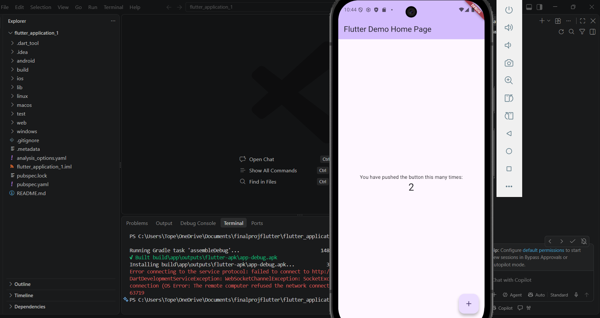
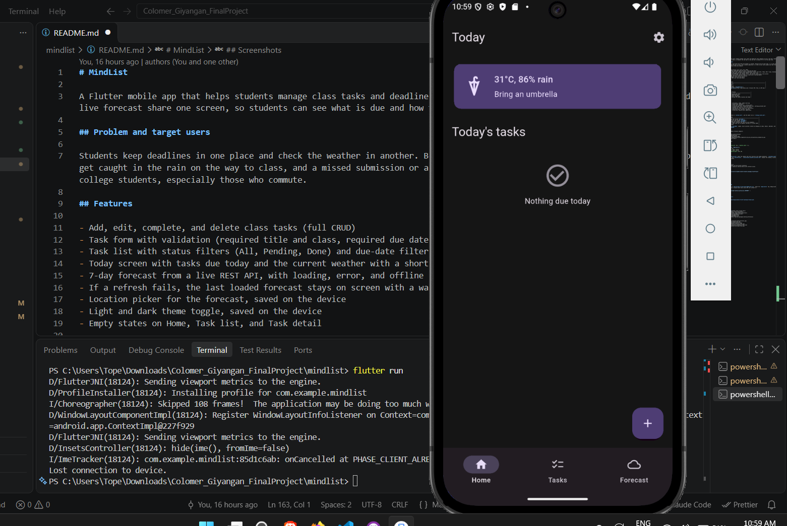
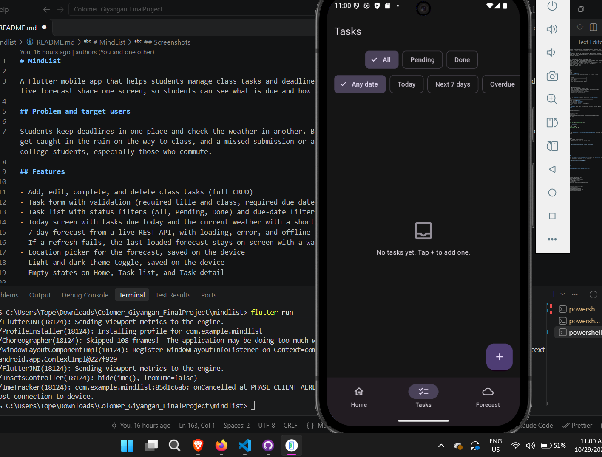
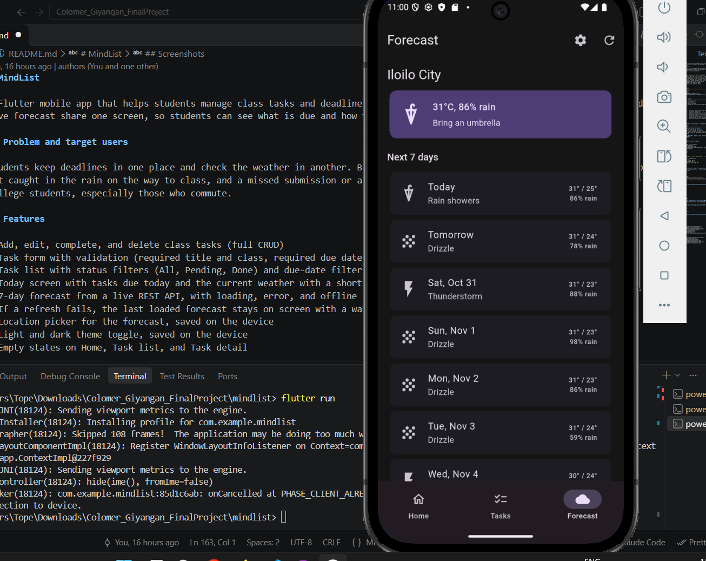
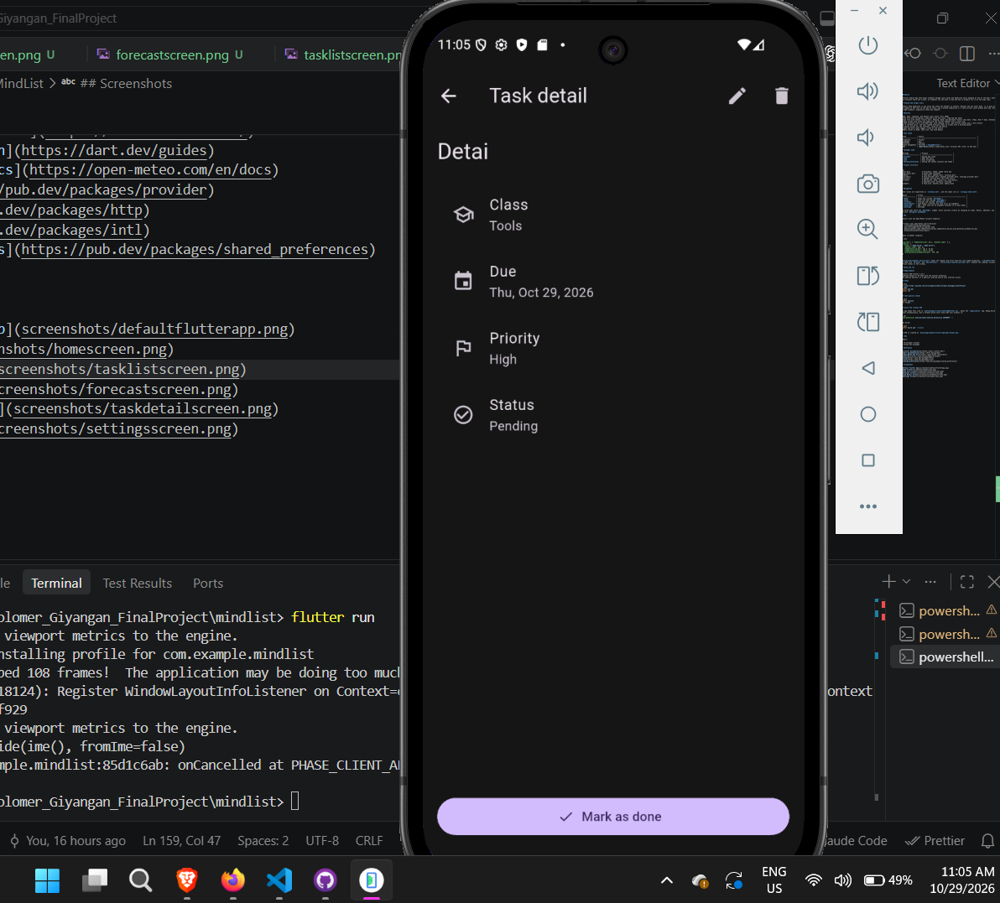
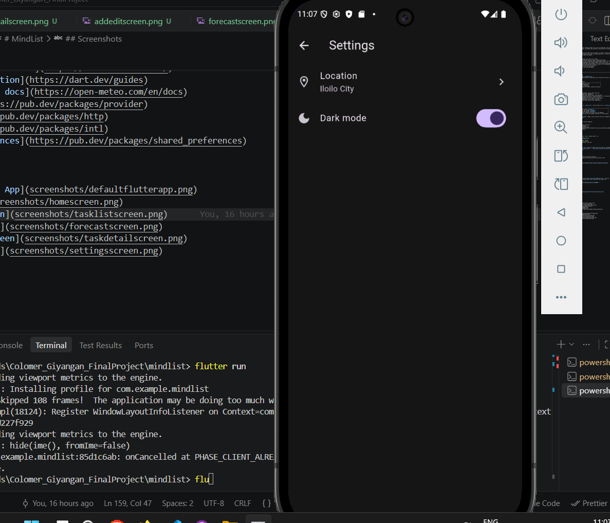
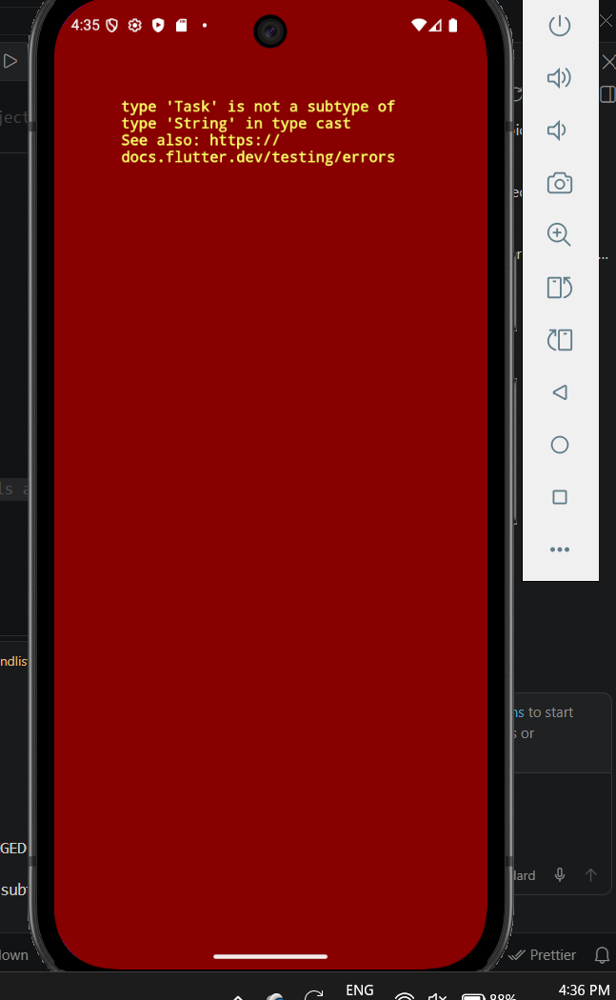

# MindList

A Flutter mobile app that helps students manage class tasks and deadlines while keeping an eye on the day's weather. Tasks and a live forecast share one screen, so students can see what is due and how to prepare for it at the same time.

## Problem and target users

Students keep deadlines in one place and check the weather in another. Because the two never meet, it is easy to miss a task or get caught in the rain on the way to class, and a missed submission or a late arrival costs grades and time. MindList is for college students, especially those who commute.

## Features

- Add, edit, complete, and delete class tasks (full CRUD)
- Task form with validation (required title and class, required due date)
- Task list with status filters (All, Pending, Done) and due-date filters (Any date, Today, Next 7 days, Overdue)
- Today screen with tasks due today and the current weather with a short tip
- 7-day forecast from a live REST API, with loading, error, and offline states and a retry button
- If a refresh fails, the last loaded forecast stays on screen with a warning banner
- Location picker for the forecast, saved on the device
- Light and dark theme toggle, saved on the device
- Empty states on Home, Task list, and Task detail

## Tech stack

| Item             | Choice                                                                |
| ---------------- | --------------------------------------------------------------------- |
| Framework        | Flutter                                                               |
| Language         | Dart                                                                  |
| Platform         | Android                                                               |
| State management | Provider (`ChangeNotifier`)                                           |
| API              | [Open-Meteo](https://open-meteo.com/) forecast API (free, no API key) |

## Packages used

| Package              | Purpose                              |
| -------------------- | ------------------------------------ |
| `provider`           | Shared app state                     |
| `http`               | REST API calls                       |
| `intl`               | Date formatting                      |
| `shared_preferences` | Saving the chosen location and theme |

## Project structure

```
lib/
  main.dart              # Providers, theme, named route map
  app_routes.dart        # Route name constants
  models/                # task.dart, weather.dart, location.dart
  providers/             # task_provider.dart, weather_provider.dart, settings_provider.dart
  services/              # weather_service.dart (all http calls)
  screens/               # bottom_nav, home, task_list, task_detail,
                         # add_edit_task, forecast, settings
  widgets/               # task_card, weather_card, empty_state
```

## Navigation

Named routes are registered in `lib/main.dart`, and the names live in `lib/app_routes.dart`.

| Route           | Screen                                                    |
| --------------- | --------------------------------------------------------- |
| `/home`         | Today tab (inside `BottomNav`)                            |
| `/tasks`        | Task list tab (inside `BottomNav`)                        |
| `/forecast`     | Forecast tab (inside `BottomNav`)                         |
| `/tasks/detail` | Task detail (receives the task id as an argument)         |
| `/tasks/add`    | Add / edit task (an id argument switches it to edit mode) |
| `/settings`     | Settings                                                  |

The three tabs share one `BottomNav` widget, which switches screens by changing an index. Detail, add/edit, and settings open on top with `Navigator.pushNamed`.

## API

MindList uses the Open-Meteo forecast endpoint:

```
GET https://api.open-meteo.com/v1/forecast
    ?latitude={lat}&longitude={lon}
    &current=temperature_2m,weather_code
    &daily=weather_code,temperature_2m_max,temperature_2m_min,precipitation_probability_max
    &timezone=auto&forecast_days=7
```

Sample (trimmed) response:

```json
{
  "current": { "temperature_2m": 29.1, "weather_code": 3 },
  "daily": {
    "time": ["2026-10-26", "2026-10-27"],
    "weather_code": [80, 3],
    "temperature_2m_max": [31.2, 32.0],
    "temperature_2m_min": [25.4, 25.9],
    "precipitation_probability_max": [70, 20]
  }
}
```

`lib/services/weather_service.dart` makes the request and turns failures into typed exceptions. `lib/models/weather.dart` parses the JSON into `Forecast` and `DailyForecast`. `lib/providers/weather_provider.dart` exposes the loading, success, error, and offline states to the screens.

## Setup and run

### Requirements

- Flutter SDK Flutter 3.47.2
- Android Studio or VS Code with the Flutter extension
- An Android emulator or a physical Android device with internet access

### Steps

```bash
git clone https://github.com/christophercolomer/Colomer_Giyangan_FinalProject
cd repo
flutter pub get
flutter run
```

### Code quality checks

```bash
flutter analyze
dart format .
```

### Build the release APK

The app needs this line in `android/app/src/main/AndroidManifest.xml`, above the `<application` tag. Debug builds add internet access automatically, but a release build fails every API call without it:

```xml
<uses-permission android:name="android.permission.INTERNET" />
```

Then build:

```bash
flutter build apk --release
```

The APK is created at `build/app/outputs/flutter-apk/app-release.apk`.

## Team

Members:

1. Christopher Colomer
2. Jeremy Don Giyangan

## References

- [Flutter documentation](https://docs.flutter.dev/)
- [Dart documentation](https://dart.dev/guides)
- [Open-Meteo API docs](https://open-meteo.com/en/docs)
- [provider](https://pub.dev/packages/provider)
- [http](https://pub.dev/packages/http)
- [intl](https://pub.dev/packages/intl)
- [shared_preferences](https://pub.dev/packages/shared_preferences)

## Screenshots








## Bug

I clicked on a task card and the red screen with error scared me for a bit but the error gave a pretty big hint and I figured it out on my own. Turns out I was passing the whole task object as an argument in .pushNamed in task_card.dart, when only the task.id was expected.

